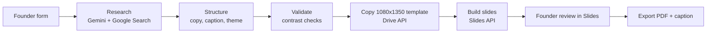

# AI Content Creation System

An n8n workflow that lets a founder turn a raw idea into a ready-to-edit Instagram or LinkedIn carousel, without a graphic designer. Built for the Product Development, Design & AI Systems intern assignment (Task 3).

Running cost: zero. Gemini free tier, Google Slides, Google Drive, and self-hosted n8n.

## Sample output

Topic: "5 reasons your pet needs a vet" (Instagram, 7 slides)

- Editable deck: (https://docs.google.com/presentation/d/1km3syM-dOMXhewgibeAcPJMk60hItLOcLfKWLSdrST4/edit?usp=sharing)
- PDF export: [output/sample-carousel.pdf](output/sample-carousel.pdf)
- Screenshots: see the [screenshots](screenshots) folder

## How it works

1. **Form.** The founder enters a raw idea, platform (Instagram or LinkedIn), slide count, and optional audience, tone and brand line.
2. **Research.** Gemini 2.5 Flash with Google Search grounding collects current facts, common mistakes and tips.
3. **Structure.** A second Gemini call returns strict JSON: headline options, slide-by-slide copy, caption, hashtags and a colour and font theme chosen for the topic.
4. **Validate.** A Code node checks text contrast and falls back to a readable colour if the theme is too weak.
5. **Copy template.** The Drive API copies a portrait 1080x1350 Google Slides template. The Slides API cannot set page size, so a template is the workaround.
6. **Build slides.** A Code node generates one Slides `batchUpdate` request list (background, numbered badge, heading, body, call-to-action button) and n8n sends it.
7. **Review and export.** The founder edits text in Google Slides. The final node outputs the edit link, a one-click PDF link, the caption, hashtags and alternative headlines.

## Tech stack

| Part | Tool | Why |
| --- | --- | --- |
| Orchestration | n8n | Free, visual, easy to hand over |
| Research and copy | Gemini 2.5 Flash (free tier) | Free, supports search grounding and JSON output |
| Design layer | Google Slides | Editable by a non-designer and scriptable |
| Template copy | Google Drive API | Keeps the carousel in portrait format |

## Call-to-action strategy

The optional Brand Line field drives the CTA. It appears as a footer on the cover and as a button-style element on the last slide. The caption also ends with an action. Changing one form field retargets the whole carousel.

## Setup

1. Install and start n8n (`npx n8n`), then import `workflow/carousel-workflow.json`.
2. Create these credentials in n8n:
   - Header Auth named `Gemini API Key`, with header name `x-goog-api-key` and your Gemini key from Google AI Studio as the value.
   - Google Slides OAuth2 API.
   - Google Drive OAuth2 API.
3. Enable the Google Slides API and Google Drive API in the same Google Cloud project.
4. Create a blank Google Slides file, set **File > Page setup > Custom** to 1080 x 1350 pixels, and delete every box on the first slide.
5. In the **Create Deck** node, replace the template ID in the URL with your own file ID.
6. Run the workflow, fill in the form, and open the `editLink` in the **Final Output** node.

No API keys are stored in this repository.

## Known limitations

- The last-slide button is a styled shape, not yet a clickable link.
- Instagram needs images, but the workflow only produces a PDF. PNG export is the next step.
- n8n runs locally. For the founder to use it independently it needs hosting.
- Gemini occasionally returns an empty research answer. Thinking is disabled on that call to reduce this, and a check that stops the run with a clear message is a planned improvement.
- The build step creates new slides on every run, so each run needs a fresh template copy (the workflow does this automatically).
